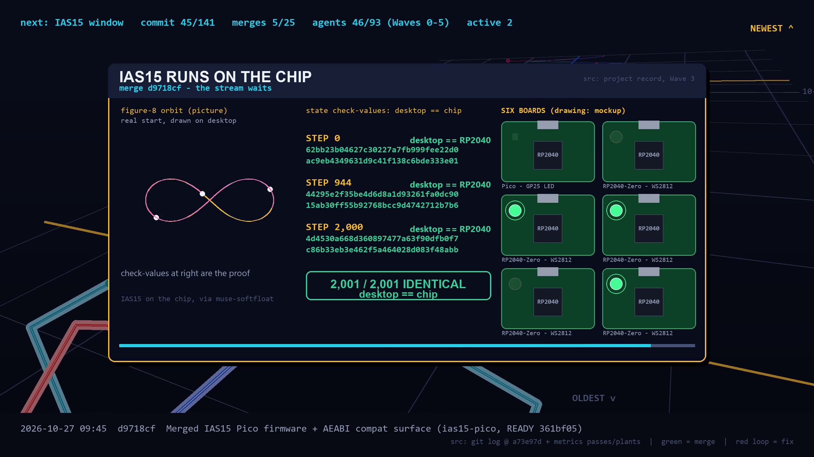

# muse-softfloat

An IEEE 754 softfloat library (binary16, binary32 and binary64) for the RP2040 whose proof workloads run bit-identical to their desktop runs, on a chip with no FPU.

[](https://github.com/loganw234/muse-softfloat/actions/workflows/ci.yml) [](LICENSE) [](https://github.com/loganw234/muse-softfloat/releases/tag/v1.0.0) [](#at-a-glance) [](#at-a-glance)

[Watch the 3-min film](https://www.youtube.com/watch?v=IzLtd2_OIFo) · [Try the live demo](https://loganw234.github.io/muse-softfloat/) · [v1.0.0 release](https://github.com/loganw234/muse-softfloat/releases/tag/v1.0.0)



*One still per scene beat is indexed in [video/out/stills_v6/](video/out/stills_v6/INDEX.md).*

## What this is

An IEEE 754 softfloat library for the RP2040 — binary16, binary32 and binary64 — built with Meta's Muse models under two working methods, [HonestFramework](https://github.com/loganw234/HonestFramework) and [ParcelRound](https://github.com/loganw234/ParcelRound) (the owner's methods, carried in the [hackathon bootstrap kit](https://github.com/loganw234/softfloat-bootstrap), not in this repository), for the Meta Global AI Developer Hackathon, 2026-10-26 to 2026-11-04.

The workload that proves it in public: **[REBOUND](https://github.com/hannorein/rebound)'s IAS15 integrator running on a Raspberry Pi Pico through this library, bit-identical to the unmodified desktop run** — same integrator source, same bits out, on a chip with no FPU. The demo is a 179-second programmatic video; this repository is the library, the video pipeline and rendered cut, and the record that stands beside them.

**Live demo:** [loganw234.github.io/muse-softfloat](https://loganw234.github.io/muse-softfloat/) — the actual library compiled to WebAssembly, runnable against the committed test vectors ([site/](site/README.md)).

**Reproduce the workloads:** `bash demo/run_demo.sh host` ([demo/](demo/README.md)) — fetches the pinned REBOUND/[KissFFT](https://github.com/mborgerding/kissfft) archives into a gitignored cache and re-proves all three workload hashes on your machine.

## At a glance

| | |
|---|---|
| Instantiations | **849 of 849** (783 Tier 1 + 66 Tier 2) |
| Committed test vectors | **411,213** |
| IAS15 on silicon | **2,001/2,001** step records on each of 6 chips; step-2000 hash `4d4530a668d360897477a63f90dfb0f7c86b33eb3e462f5a464028d083f48abb` (board == native) |
| Library since the v1.0.0 tag | `git diff v1.0.0..HEAD -- include src compat tables` is empty in this tree |
| Planted-defect score | **177/185** caught (recount it yourself — see step 5 below) |
| Live demo | [loganw234.github.io/muse-softfloat](https://loganw234.github.io/muse-softfloat/) |

## Quickstart

From nothing to the proofs (Git Bash on Windows):

```
git clone https://github.com/loganw234/muse-softfloat.git
cd muse-softfloat
bash tools/run.sh smoke
bash demo/run_demo.sh host
```

`bash tools/run.sh smoke` is the fast test gate (a passing run ends `budget smoke: PASS`); `bash demo/run_demo.sh host` reproduces the three workload proofs and needs the network once. The guided tour below explains what each step shows.

## Start here

Five steps, in order: watch, click, run, reproduce, audit. Each step stands on its own, so stop whenever you have seen enough.

1. **Watch the film (about three minutes).** [video/out/assembly_v6.mp4](video/out/assembly_v6.mp4) runs 179 seconds at 2560x1440 (cut on a 124 BPM grid for music sync) and tells the whole story: the library, the orbit integrator running on the Pico, and how every answer was checked. The copy in this repo is silent for music licensing: the soundtrack ("Sunflower Dance" by Helmut Schenker, courtesy of Epidemic Sound, under the owner's Pro subscription) is cleared for the owner's channels, so the version with sound is hosted as an [unlisted video on the owner's YouTube account](https://www.youtube.com/watch?v=IzLtd2_OIFo). There is nothing wrong with your speakers. How it was made: [video/README.md](video/README.md).
2. **Try the library in your browser (a minute).** The [live site](https://loganw234.github.io/muse-softfloat/) runs the actual library, compiled to WebAssembly — not a recording. Under "The instrument", press **Deal me a committed vector**, then **Run**, and compare the result bits and flags with the dealt line; or pick a format and operation and type your own operands. 822 of the 849 operations run there; the page itself names the ones it leaves out and why. Then skim "The numbers", "On silicon", and "How this was verified". How the page is built: [site/README.md](site/README.md).
3. **Run it yourself (set aside five minutes).** From the root of a fresh clone (Git Bash on Windows), first:

   ```
   bash examples/host/build.sh
   ```

   That builds the library plus one small example program, runs it, and checks every printed line against the committed expected output ([examples/](examples/README.md) explains what the example shows; a matching Pico version lives beside it). Then the fast test gate:

   ```
   bash tools/run.sh smoke
   ```

   It rebuilds everything, runs the unit tests and all 411,213 committed test vectors, and finishes with checks that are designed to be refused — a passing run ends `budget smoke: PASS` (27 seconds on the project desktop when this map was written; that is a record from that machine, not a promise about yours). The same gates run on Linux for every push ([.github/workflows/ci.yml](.github/workflows/ci.yml), four jobs: `smoke`, `standard`, `example-host`, and `sanitize`), and a fifth job runs `smoke` then `standard` on Windows (MSYS2 UCRT64). `standard` is the bigger gate a merge must pass, and `example-host` re-runs the example above. The full `sanitize` flavour runs only in that CI job; the project Windows host runs its lighter trap flavour.
4. **Reproduce the three workload proofs (a few more minutes, needs network once).**

   ```
   bash demo/run_demo.sh host
   ```

   This downloads two pinned archives, checks their hashes before opening them, and re-runs the three public workloads on your machine: the orbit integrator for 2,000 steps (2,001 step records compared), KissFFT with its one named change (12 configurations compared; the change is described in [demo/README.md](demo/README.md) and [docs/TWIDDLES.md](docs/TWIDDLES.md)), and a 710-row interval-geometry catalogue (hash `ae04caf0…c1422`; counted library calls are part of that hash). All three legs passed when this map was written.
5. **Audit how it was made (as deep as you like).** Start with [docs/RECORD.md](docs/RECORD.md), the dated history of what was claimed and when — failures stay in it. Then follow the reading order under "How to audit" in [audit-bundle/README.md](audit-bundle/README.md): the record first, then the frozen briefs and ledgers behind any line of it, then the planted-defect grades against their keys, then the method rules and the final adherence report, then re-run the gates from step 3. The current bundle is [audit-bundle-v2/](audit-bundle-v2/README.md): 1,841 frozen files with an LF SHA-256 manifest, frozen at the submission seal (the v1 bundle, 576 files frozen when the library was completed, is retained beside it unedited). The planted-defect score: before each piece of work merged, an independent verifier checked it against a copy carrying deliberate hidden defects. Counting the rows in [docs/metrics/plants.jsonl](docs/metrics/plants.jsonl) in this tree gives 177 caught of 185 (Wave 6: 44 of 45; post-seal: 15 of 15) — recount it yourself; there is one line per plant.

## Status

**Tier 1 and Tier 2 complete: 849 of 849 instantiations, three workloads bit-identical on silicon.** [SF-0](docs/studies/SF-0.md), [SF-1](docs/studies/SF-1.md) and [SF-2](docs/studies/SF-2.md) are the approved plans of record. Per-instantiation status lives in [docs/COVERAGE.tsv](docs/COVERAGE.tsv); the story, with its slips attributed, is [docs/RECORD.md](docs/RECORD.md).

### Library

- The full Clause 5 surface for binary16/32/64 is implemented and gated (783/783) — arithmetic, FMA, conversions, comparisons, totalOrder, and correctly rounded decimal/hex character conversions (H=20).
- Plus all 66 Tier 2 rows (66/66), every family at all three formats: Clause 9.6 minimum/maximum semantics, the Clause 9.7 payload accessors, correctly rounded `sinPi`/`cosPi`, `rSqrt`/`hypot`, and the `exp2`/`exp2m1` and `log2`/`log2p1` pairs (Clause 9.2), and Clause 9.5 augmented addition/subtraction/multiplication.
- `roundTiesToAway` is the fifth public rounding attribute across the 273 attribute-carrying rows; the augmented operations instead use the clause-fixed roundTiesTowardZero (no caller attribute), with pin P1 = R2: an exact tiny residual signals underflow but raises no flag, and only the unrepresentable multiplication residual raises underflow+inexact.
- Each row is gated against [Berkeley TestFloat 3e](https://www.jhauser.us/arithmetic/TestFloat-3e.zip), [MPFR](https://www.mpfr.org/), or an exact reference at the volume its authority names (411,213 committed vectors; `standard` adds 1,117,504 generated checks plus a 5,505,024-check binary16 augmented-pool differential).

<details>
<summary>Exhaustive one-time sweeps (recorded evidence beyond the budgets)</summary>

Recorded one-time evidence beyond the budgets: binary32 exhaustive for each of the `exp2` and `log2` pairs (42,949,672,960 mode-checks each, zero mismatches) and binary16 augmented pairs exhaustive (12,884,901,888 pair checks, zero mismatches) — [docs/RECORD.md](docs/RECORD.md) carries the shard and census detail.

</details>

### Proof

Three workloads run bit-identically on the RP2040:

- **REBOUND's IAS15 integrator** over the AEABI compat surface reproduces the unmodified desktop build's state hashes for 2,000 steps (2,001/2,001 records) on each of six chips — the genuine Pico and five RP2040-Zero clones, with the LED-activity firmware build itself re-verified at 968/968 harness vectors on all six.
- **An interval-geometry catalogue** streams host==board bit-for-bit.
- **KissFFT** — BSD-3, scratch-only, with the one named Fork B change (exact cycle fractions into `sinpi`/`cospi`; derivation in [docs/TWIDDLES.md](docs/TWIDDLES.md)) — matches all 12 configuration hashes at the gated sizes N=256/1024/4096.

<details>
<summary>Hash and counted-call details</summary>

- IAS15 step 2000: the first hash on the step-2000 record is `4d4530a668d360897477a63f90dfb0f7c86b33eb3e462f5a464028d083f48abb`, identical in [demo/expected-ias15.txt](demo/expected-ias15.txt) and in the board and native captures ([video/data/hashes_board.txt](video/data/hashes_board.txt), [video/data/hashes_native.txt](video/data/hashes_native.txt)).
- The interval workload's exact stage now consumes the augmented operations (Wave 6): over the frozen catalogue its counted library calls measured 616,754 → 396,745 (stage 3 alone 283,314 → 63,305; the SF-2 study model predicted 394,666 — the difference is three kept negates per sphere row), with classifications identical on every row and the new host == board IW1 hash `ae04caf0…c1422`. These are counted records, not timing claims.

</details>

**The front door** is `tools/run.sh <smoke|standard|board|bench|sanitize>` under Git Bash: it prints its inventory before any verdict, refuses drift and each named negative control, and `standard` is the merge gate (AGENTS.md has the budgets and their measured costs). The fifth budget, `sanitize`, runs the host runners under sanitizer instrumentation — the trap flavour on this Windows host, the full ASan+UBSan flavour on Linux — with deliberate-violation canaries watched first so a green run proves the instrumentation was live; a flavour whose runtime is absent skips by name and prints no PASS verdict. CI ([.github/workflows/ci.yml](.github/workflows/ci.yml)) runs four Ubuntu jobs on every push and pull request — `smoke`, `standard`, `example-host` (the host example's output diff enforced there too), and `sanitize` at the full flavour — plus a Windows (MSYS2 UCRT64) job running `smoke` then `standard`, and keeps each job's gate logs as artifacts; `board` and `bench` stay lead-run against the physical RP2040 and are not part of CI. Measured bench records (cycles/op medians under both SDK flavours, records only) live in [docs/BENCH.md](docs/BENCH.md).

<details>
<summary>Measured bench records — built for exactness, not speed (records only)</summary>


The full suite — every library row plus stock-SDK baseline rows — was re-measured fresh on the genuine Pico under both SDK flavours (pico default and `compiler`): 5 repetitions per row, flash XIP cached at 125 MHz, full tables in [docs/BENCH.md](docs/BENCH.md). The stock baseline rows now share the library rows' loop shape, with operands regenerated from the same in-code generator on every iteration and results folded into a printed sink. The honest position: this library pays cycles for full IEEE semantics — correct rounding under every rounding attribute, exception flags, exact results — that the stock routines do not provide, and these records show what that measured out as on these runs. From the labelled `bench-pico` run (median cycles/op of 5 repetitions): binary32 add/mul/div 3855.66 / 2115.44 / 48568.26; binary64 add/mul/div 3758.06 / 2018.40 / 57083.63. These are measured records of those runs, never performance claims, and no correctness verdict rests on them; the full matrix and the all-library-rows graph are in [docs/BENCH.md](docs/BENCH.md).

</details>

### Process

- Verified wave by wave on planted copies by independent verifiers (177 of 185 plants caught, as counted from `docs/metrics/plants.jsonl` in this tree).
- Wave 6 also landed the on-ramp in [examples/](examples/README.md) (the same small program over the public API on host and Pico, its host output pinned and diff-enforced by `examples/host/build.sh`; the Pico program printed every host-expected line on the genuine board at its merge gate, a RECORD entry), Linux CI, and a `sanitize` gate budget (both described under Proof above).
- SF-2 is complete: its four steps (fifth attribute, `rSqrt`/`hypot`, `exp2`/`log2` pairs, augmented arithmetic) are all merged, and Wave 6 queue items 1–4 (augmented consumption, Linux CI, the sanitize budget, the examples on-ramp) have landed since; submission packaging, including the map above, follows.

<details>
<summary>Earlier plant-score pins and the metrics cutoff</summary>

Earlier text here pinned 172 of 180 at the post-seal bench/CI landing, 162 of 170 at the seal and 153 of 160, 148 of 155 and 138 of 145 at earlier Wave 6 landings and 114 of 120 at `bc807e6`. The metrics ledgers in [docs/metrics/](docs/metrics/README.md) were refreshed through the Wave 6 close at the seal (usage 128 rows, passes 131, escalations 23 after three late audit rows, briefs 48, plants 185 counted in this tree); the refreshed billed total is 1,418,065,198 tokens at that cutoff, and the handful of seal sessions after it are named unrowed in RECORD. The plant score above is counted from `docs/metrics/plants.jsonl` as it stands in this tree.

</details>

<details>
<summary>Deliberately not implemented (full list, by name)</summary>

Still deliberately not implemented — deferred or refused by name in SF-1 §7 and SF-2 §1: the remaining Clause 9.2 functions (`pown`/`compound`/`rootn`, the other exp/log bases, `tanPi` and the inverse-Pi set, radian trig, hyperbolics; `pow`/`powr` refused in any first sequence), Clause 9.4 reductions, dynamic rounding wrappers, and public `roundToOdd`. Binary128, decimal formats, and Clause 8 alternate exception handling are out of this project entirely (SF-0 §2.7). Anything beyond this list needs a new study and owner approval before it is briefed.

</details>

## Demo video

The current cut is the 179.0-second, 2560x1440 [video/out/assembly_v6.mp4](video/out/assembly_v6.mp4) (the v5 169-second cut remains beside it; the original 180-second 1080p cut is [video/out/final.mp4](video/out/final.mp4)). Its frame-rendering pipeline, data loaders, timelines, and source-traced storyboard live in [video/](video/README.md).

The repo copy is silent for music licensing. Segments are built on a 120 BPM grid and the assembly is tempo-scaled to 124 BPM; the chosen track (["Sunflower Dance" by Helmut Schenker](https://www.epidemicsound.com/music/tracks/5002d052-2046-4b83-b126-5f4de70ea97e/), courtesy of Epidemic Sound; natively 124 BPM, 183.9 s) was time-compressed ~2.7% to fit the 179.0-second cut exactly, and that soundtrack version is hosted as an [unlisted video on the owner's YouTube account](https://www.youtube.com/watch?v=IzLtd2_OIFo) — the owner's Pro licence covers his channels, not redistribution from this repo, and the raw track is never committed here ([video/MUSIC.md](video/MUSIC.md) has the licensing record).

Captions for either version: [video/out/assembly_v6.srt](video/out/assembly_v6.srt) (+ `.vtt`), generated from the segments' own audit tables by [video/captions.py](video/captions.py); a still per scene beat is indexed in [video/out/stills_v6/](video/out/stills_v6/INDEX.md).

## Where things live

| path | what |
|---|---|
| `docs/KICKOFF.md` | the owner's words verbatim, the lead's readings, open questions |
| `docs/HARNESS.md` | how the methods' mechanisms map onto Muse, measured |
| `docs/BOARD.md` | the Pico: protocol and filled details |
| `docs/BENCH.md` | measured bench records on the Pico: labelled runs generated from retained raw logs (records, never claims) |
| `docs/studies/` | SF-0, SF-1 and SF-2, the approved plans of record |
| `docs/RECORD.md` | dated run entries, the project's record |
| `docs/COVERAGE.tsv` | per-instantiation coverage ledger: status, deciding authority, vector set (generated) |
| `docs/WIDTHS.md` | internal exact-integer widths, with proof notes |
| `docs/TWIDDLES.md` | the KissFFT Fork B twiddle-provenance derivation, retained in full |
| `tables/` | the format + operation tables everything else is generated from |
| `include/`, `src/` | the library: generated public header, exact-integer core |
| `compat/` | AEABI/toolchain compatibility layer (per-core wrapper state) |
| `tests/` | host runner, exact-reference vector generation, committed vector sets |
| `board/` | RP2040 firmware: CDC replay harness, interposition hello, IAS15 / interval / KissFFT workloads, bench skeleton |
| `examples/` | the on-ramp: the same small public-API program on host (one-command build/run/diff) and on the Pico |
| `demo/` | one-script reproduction of the three workload proofs from a fresh clone |
| `site/` | the live demo page: the library in WebAssembly over the committed vectors |
| `audit-bundle-v2/` (+ `audit-bundle/`) | frozen method evidence for external auditing: kit, ledgers, plant keys, reports, with hash manifests (v2 current at the seal, v1 retained unedited) |
| `.github/workflows/` | CI (`ci.yml`: Ubuntu smoke, standard, example-host, sanitize + Windows smoke/standard) and the Pages publish workflow |
| `tools/` | the front door (`run.sh`: smoke, standard, board, bench, sanitize), table generator, metrics extractor |
| `video/` | programmatic demo-video pipeline, IAS15 hash captures, storyboard, rendered cuts |
| `docs/metrics/` | the metrics inputs (usage, passes, briefs, fetches, …) |
| `AGENTS.md` | notes for agents: the front door, the authority, what bites |

The working ledger, briefs and per-agent scratch live outside this repository (ParcelRound §4) and are archived with timestamps at the round's close.

## Ground rules this repo is built under

- Every claim about correctness is held against a named executable authority (SF-0 names it; IEEE 754-2019 is the contract, not the oracle).
- A gate that has not been watched to fail is not a gate; negative controls are permanent, named in each brief, and run.
- Work is split into parcels with briefs; a verifier that only disconfirms stands between each parcel and the push to this public remote. The lead's own wiring/record commits are not planted-verified parcel-style; they are gated by `standard` and named as lead work in RECORD (the final adherence audit grades the distinction) — local commits may be restated in place until pushed.
- Git operations run under the owner's standing permission (2026-10-26); his words and the lead's readings are in `docs/KICKOFF.md`. Commits carry detailed bodies with verification and ledger references, and AI-authored commits carry the committing model's Co-Authored-By trailer.
- Developed clean-room from the standard: no third-party softfloat source is copied into the library, even where licences allow (SF-0 §4.5). Oracles are fetched by recorded hash and only executed.

## Licence

MIT — see [LICENSE](LICENSE) (Copyright (c) 2026 Logan W.). Third-party code keeps its own licence; REBOUND is GPL and will appear, if at all, only as a separately-licensed demo workload, never inside the library.


